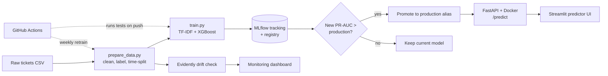

# Support Ticket Escalation Prediction — End-to-End MLOps

An end-to-end ML system that predicts whether a support ticket will need escalation, from its text and metadata. It covers data prep, modeling, experiment tracking, a containerized API, CI/CD with automated retraining, and drift monitoring.


## Results

| Model | Precision | Recall | F1 | PR-AUC |
|---|---|---|---|---|
| Logistic Regression (baseline) | 0.53 | 0.88 | 0.66 | - |
| XGBoost (tuned) | 0.56 | 0.86 | 0.68 | **0.763** |

- Escalation ROC-AUC: 0.919 (about 21% positive class, 11,922 English tickets)
- Priority (3-class) accuracy: 0.59. Errors are concentrated between adjacent levels, which points to inconsistent human labels rather than a modeling limit (see `docs/model_findings.md`).

## Architecture



## What's inside

- **Data and labeling** (`src/data/`): English-only filtering, validation checks, a documented rule-based escalation label, and a time-based train/validation split to avoid leakage.
- **Modeling** (`src/models/`): TF-IDF text features, one-hot categoricals, and the top 100 tags, with class-imbalance handling and SHAP interpretability.
- **Tracking** (MLflow): runs are compared and the best model is registered. A promotion script only replaces production when the new model has a higher PR-AUC.
- **Serving** (`src/serving/`): a FastAPI service with Pydantic validation, packaged with Docker and covered by pytest integration tests.
- **CI/CD** (`.github/workflows/`): tests run on every push. A second workflow regenerates data, retrains, and applies the promotion check. It runs weekly and can be triggered manually.
- **Monitoring** (`src/monitoring/`, `dashboard/`): Evidently drift reports and a Streamlit dashboard. The detector was validated on both clean data (0% drift) and an injected drift event (correctly flagged `type` and `text_length` only).


## Run it locally

```bash
python -m venv .venv && source .venv/bin/activate
pip install -r requirements.txt

python src/data/prepare_data.py
python src/models/train.py

uvicorn src.serving.main:app --port 8000        # API
streamlit run dashboard/predict_app.py          # predictor UI
streamlit run dashboard/app.py                  # monitoring dashboard
pytest tests/ -v
```

Or with Docker:

```bash
docker build -t ticket-escalation-api -f docker/Dockerfile .
docker run -p 8000:8000 ticket-escalation-api
```

## Limitations (stated honestly)

- **The escalation label is a proxy.** The dataset has no real escalation outcomes, so the label is derived from ticket type, priority, and severity tags (`docs/labeling_methodology.md`). Because those signals are also available as features, part of the model's score reflects learning that rule. In production this would be replaced by real escalation events, and an intake-time model should rely on text only.
- **Timestamps are synthetic.** The source data has no dates, so they were assigned to enable time-based splitting and drift simulation.
- **Drift is simulated.** There is no live traffic, so drift was demonstrated by injecting a shifted batch.
- **CI uses an ephemeral MLflow store.** Each GitHub Actions run starts with a fresh SQLite database, so the promotion check compares against an empty registry. A real deployment would use a shared tracking server.
- **English only.** Multilingual tickets were scoped out.

## Docs

- `PROJECT_BRIEF.md`: scope and success metrics
- `docs/labeling_methodology.md`: how the escalation label was built
- `docs/model_findings.md`: model, SHAP, and drift analysis
- `docs/decisions.md` and `docs/adr/`: key decisions and their reasoning

## Tech stack

Python, scikit-learn, XGBoost, SHAP, MLflow, FastAPI, Docker, GitHub Actions, Evidently, Streamlit, pytest